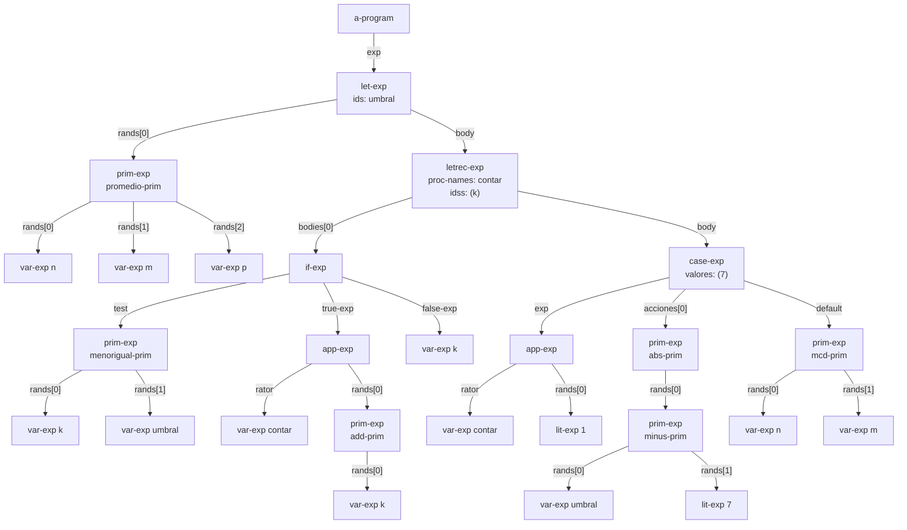
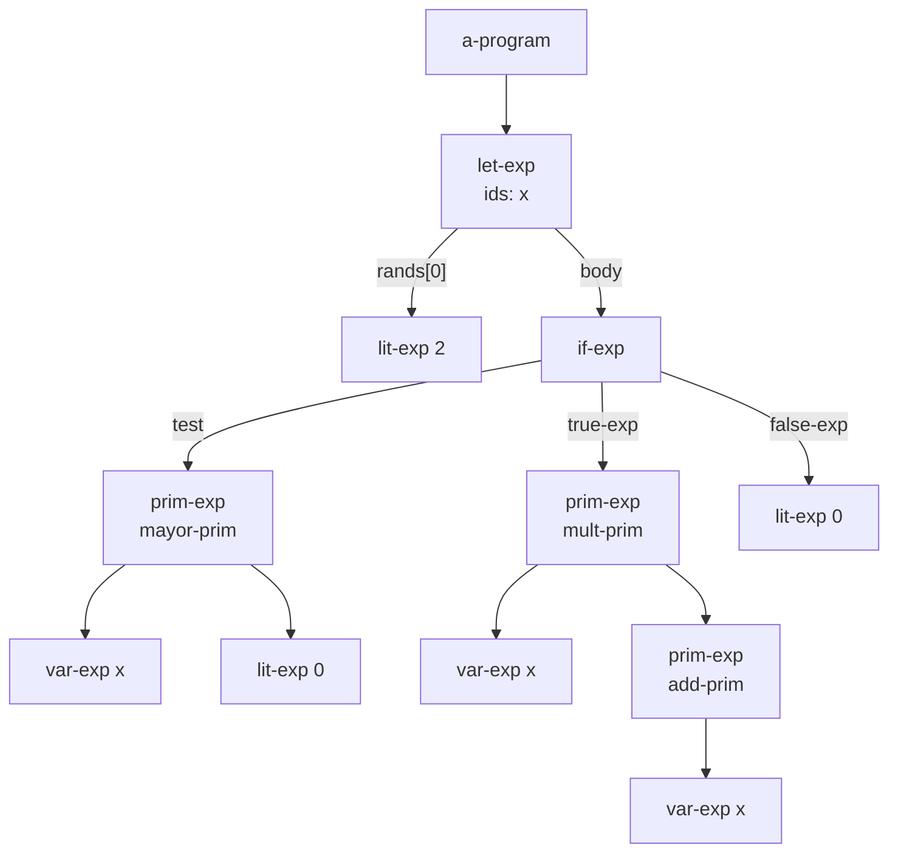
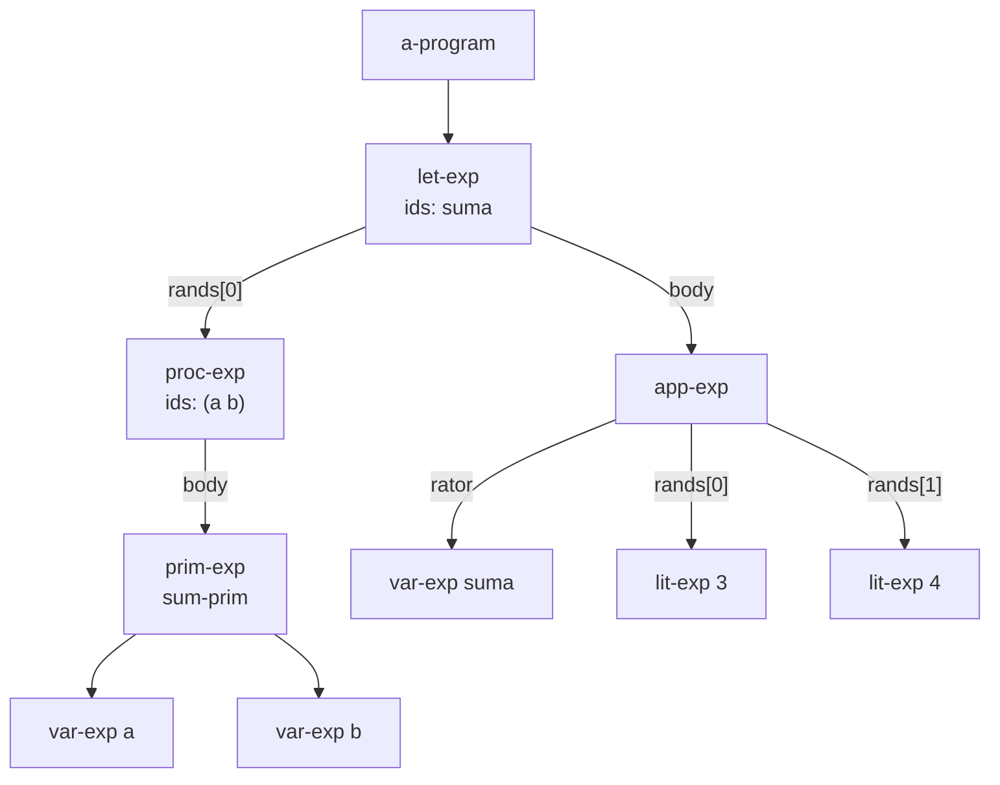
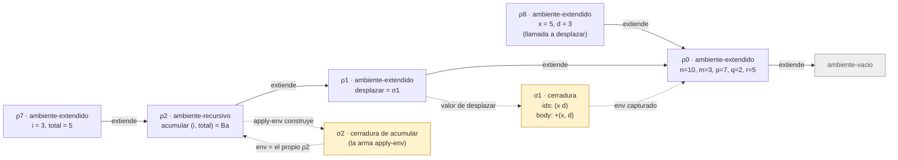

# Informe de AST — Taller 2: El intérprete de Cauca

**Curso:** Fundamentos de Interpretación y Compilación de Lenguajes
de Programación — Universidad del Valle, Sede Tuluá.

**Integrantes del grupo:**

| Nombre | Código | Correo institucional |
|--------|--------|----------------------|
| Juan Eduardo Calderon Jaramillo | 2611001-3743 | juan.eduardo.calderon@correounivalle.edu.co |
| Jesus David Lopez Diaz | 2611029-3743 | jesus.david.lopez@correounivalle.edu.co |
| Carlos Humberto Gutierrez Mejia | 2059817-3743 | carlos.humberto.gutierrez@correounivalle.edu.co |

---

## 1. Gramática considerada

Gramática completa de Cauca (Partes 1 a 4), tal como está en
`src/sintaxis.rkt`. Debajo de cada producción va el constructor del datatype
que genera `sllgen:make-define-datatypes`.

```bnf
<programa>  ::= <expresion>
                a-program(exp)

<expresion> ::= <numero>
                lit-exp(dato)
            ::= <identificador>
                var-exp(id)
            ::= "true"
                true-exp()
            ::= "false"
                false-exp()
            ::= <primitiva> "(" {<expresion>}*(,) ")"
                prim-exp(prim, rands)
            ::= "if" <expresion> "then" <expresion> "else" <expresion> "end"
                if-exp(test, true-exp, false-exp)
            ::= "let" {<identificador> "=" <expresion>}* "in" <expresion> "end"
                let-exp(ids, rands, body)
            ::= "proc" "(" {<identificador>}*(,) ")" <expresion> "end"
                proc-exp(ids, body)
            ::= "apply" <expresion> "(" {<expresion>}*(,) ")"
                app-exp(rator, rands)
            ::= "letrec" {<identificador> "(" {<identificador>}*(,) ")" "=" <expresion>}*
                "in" <expresion> "end"
                letrec-exp(proc-names, idss, bodies, body)
            ::= "case" <expresion> {"of" <numero> "=>" <expresion>}*
                "otherwise" "=>" <expresion> "end"
                case-exp(exp, valores, acciones, default)

<primitiva> ::= "+" sum-prim() | "-" minus-prim() | "*" mult-prim() | "/" div-prim()
            ::= "add1" add-prim() | "sub1" sub-prim()
            ::= ">" mayor-prim() | ">=" mayorigual-prim()
            ::= "<" menor-prim() | "<=" menorigual-prim() | "==" igual-prim()
            ::= "not" not-prim() | "and" and-prim() | "or" or-prim()
            ::= "abs" abs-prim() | "mcd" mcd-prim() | "mcm" mcm-prim()
            ::= "promedio" promedio-prim() | "xor" xor-prim()
            ::= "implica" implica-prim() | "entre" entre-prim()
```

Nota de implementación: SLLGEN no tiene la clausura $\{\ldots\}^{+}$, así que las
ramas de `case-exp` se declaran con `arbno` (cero o más ramas).

---

## 2. Ejemplos de AST

### Ejemplo 1 — Programa de la Parte 5.1 (`promedio`, `letrec`, `case`)

**Expresión concreta:**

```scheme
let umbral = promedio(n, m, p)
in
letrec
contar (k) = if <=(k, umbral)
then apply contar (add1(k))
else k
end
in
case apply contar (1)
of 7 => abs(-(umbral, 7))
otherwise => mcd(n, m)
end
end
end
```

**AST:** cada nodo lleva el nombre del constructor; la etiqueta de cada arista
es el campo del constructor al que pertenece el hijo.



**Explicación:** la raíz es `a-program` con una sola expresión. El `let-exp`
liga `umbral` a un `prim-exp` con tres `var-exp`; su cuerpo es el `letrec-exp`,
que declara un procedimiento (`contar`, parámetro `k`) cuyo cuerpo es un
`if-exp`. El `test` es `prim-exp` con `menorigual-prim`; la rama verdadera es un
`app-exp` cuyo operador es `var-exp contar` y cuyo único argumento es
`prim-exp` con `add-prim`; la rama falsa es `var-exp k`. El cuerpo del `letrec`
es el `case-exp`: la expresión de control es un `app-exp`, hay una sola rama
(`valores = (7)`) cuya acción es `abs(-(umbral, 7))` (dos `prim-exp` anidados) y
la rama `otherwise` es `mcd(n, m)`.

Con el programa bien evaluado: `umbral` $= \tfrac{10+3+7}{3} = \tfrac{20}{3}$;
`contar(1)` sube $k$ hasta 7, que es el primer entero mayor que $\tfrac{20}{3}$;
el `case` toma la rama de 7 y el resultado es
$|\tfrac{20}{3} - 7| = \tfrac{1}{3}$.

Representación equivalente con `ast->lista` (de `src/sintaxis.rkt`), útil para
comparar con la salida del parser:

```scheme
(a-program
  (let-exp (umbral)
    ((prim-exp promedio-prim ((var-exp n) (var-exp m) (var-exp p))))
    (letrec-exp (contar) ((k))
      ((if-exp (prim-exp menorigual-prim ((var-exp k) (var-exp umbral)))
         (app-exp (var-exp contar)
           ((prim-exp add-prim ((var-exp k)))))
         (var-exp k)))
      (case-exp (app-exp (var-exp contar) ((lit-exp 1)))
        (7)
        ((prim-exp abs-prim
           ((prim-exp minus-prim
              ((var-exp umbral) (lit-exp 7))))))
        (prim-exp mcd-prim ((var-exp n) (var-exp m)))))))
```

---

### Ejemplo 2 — Condicional con ligadura local

**Expresión concreta:**

```scheme
let x = 2
in if >(x, 0) then *(x, add1(x)) else 0 end
end
```

**AST:**



**Explicación:** el `let-exp` guarda los identificadores y las expresiones en
listas paralelas (`ids`, `rands`) y su cuerpo es un único `if-exp`. El
`prim-exp` de la rama verdadera anida otro `prim-exp` (`add-prim`) como segundo
argumento.

---

### Ejemplo 3 — Procedimiento y su aplicación

**Expresión concreta:**

```scheme
let suma = proc (a, b) +(a, b) end
in apply suma (3, 4) end
```

**AST:**



**Explicación:** `proc-exp` guarda solo los parámetros y el cuerpo sin evaluar;
la clausura aparece en tiempo de evaluación, no en el AST. El operador del
`app-exp` es una expresión cualquiera (`var-exp suma`), por eso la gramática
exige la palabra `apply`.

---

## 3. Traza de evaluación

**Expresión a evaluar:**

```scheme
let desplazar = proc (x, d) +(x, d) end
in
letrec
acumular (i, total) = if >(i, m)
then total
else apply acumular
(add1(i), apply desplazar (total, i))
end
in
apply acumular (1, q)
end
end
```

**Ambiente inicial:**
$\rho_0 = [\,n = 10,\ m = 3,\ p = 7,\ q = 2,\ r = 5\,]$, que es un
`ambiente-extendido` sobre `ambiente-vacio`.

**Notación.** $\rho \oplus [\,x_1 = v_1, \ldots\,]$ es el ambiente que extiende
a $\rho$ con las ligaduras dadas (`ambiente-extendido`). Abreviaturas:

- $B_d$ es el cuerpo `+(x, d)`.
- $B_a$ es el `if-exp` completo, cuerpo de `acumular`.
- $\sigma_1 = \langle \texttt{cerradura}\ (x\ d)\ B_d\ \rho_0 \rangle$ es la
  clausura de `desplazar`.
- $\rho_2 = \texttt{ambiente-recursivo}([\texttt{acumular}],\ [(i\ total)],\ [B_a],\ \rho_1)$.
- $\sigma_2 = \langle \texttt{cerradura}\ (i\ total)\ B_a\ \rho_2 \rangle$ es la
  clausura que `apply-env` construye cada vez que busca `acumular` en $\rho_2$.

**Pasos de la traza** (cada paso: expresión, ambiente y resultado):

1. $\text{value-of}(\texttt{programa},\ \rho_0)$ evalúa la expresión del programa en
   $\rho_0$; es el `let-exp` externo.

2. **`let`: se evalúa el rand** (en el ambiente actual $\rho_0$).
   $\text{value-of}(\texttt{proc (x, d) +(x, d) end},\ \rho_0) = \sigma_1$.
   El cuerpo no se evalúa; la clausura guarda $\rho_0$.

3. **`let`: se extiende el ambiente y se evalúa el cuerpo.**
   $\rho_1 = \rho_0 \oplus [\,\texttt{desplazar} = \sigma_1\,]$.
   $\text{value-of}(\texttt{letrec} \ldots,\ \rho_1)$.

4. **`letrec`: se crea el ambiente recursivo** (no se construye ninguna clausura todavía).
   $\rho_2 = \texttt{ambiente-recursivo}([\texttt{acumular}], [(i\ total)], [B_a], \rho_1)$.
   $\text{value-of}(\texttt{apply acumular (1, q)},\ \rho_2)$.

5. **Operador.**
   $\text{value-of}(\texttt{acumular},\ \rho_2)$: `apply-env` encuentra
   `acumular` en la variante recursiva y construye
   $\sigma_2 = \langle \texttt{cerradura}\ (i\ total)\ B_a\ \rho_2 \rangle$.
   Es un procedimiento (`procval?` verdadero).

6. **Operandos, de izquierda a derecha, en $\rho_2$.**
   $\text{value-of}(\texttt{1},\ \rho_2) = 1$.
   $\text{value-of}(\texttt{q},\ \rho_2) = 2$ (no está en $\rho_2$, no está en
   $\rho_1$, se encuentra en $\rho_0$).

7. **Llamada 1.** Dos argumentos para dos parámetros.
   $\text{apply-procedure}(\sigma_2, (1\ 2))$ evalúa $B_a$ en
   $\rho_3 = \rho_2 \oplus [\,i = 1,\ total = 2\,]$.

8. **Condición, en $\rho_3$.**
   $\text{value-of}(\texttt{>(i, m)},\ \rho_3)$: $i = 1$ (en $\rho_3$) y
   $m = 3$ (se llega a $\rho_0$ pasando por $\rho_2$ y $\rho_1$).
   $\text{test-value} = \#f$, es booleano, se toma la rama `else`.

9. **Rama `else`, en $\rho_3$.**
   $\text{value-of}(\texttt{apply acumular (add1(i), apply desplazar (total, i))},\ \rho_3)$.
- Operador: `acumular` $\to \sigma_2$ (de nuevo desde $\rho_2$).
- Primer operando: $\text{value-of}(\texttt{add1(i)}, \rho_3) = 2$.
- Segundo operando: $\text{value-of}(\texttt{apply desplazar (total, i)}, \rho_3)$.
  Operador `desplazar` $\to \sigma_1$ (se encuentra en $\rho_1$); argumentos
  $total = 2,\ i = 1$; `apply-procedure` evalúa $B_d$ en
  $\rho_4 = \rho_0 \oplus [\,x = 2,\ d = 1\,]$.
  $\text{value-of}(\texttt{+(x, d)},\ \rho_4) = 3$.

10. **Llamada 2** (primera llamada recursiva):
    $\text{apply-procedure}(\sigma_2, (2\ 3))$ evalúa $B_a$ en
    $\rho_5 = \rho_2 \oplus [\,i = 2,\ total = 3\,]$.
    $\text{value-of}(\texttt{>(i, m)}, \rho_5) = \#f$ (con $2 > 3$ falso).
    $\text{value-of}(\texttt{add1(i)}, \rho_5) = 3$.
    $\text{desplazar}(3, 2)$ evalúa $B_d$ en
    $\rho_6 = \rho_0 \oplus [\,x = 3,\ d = 2\,]$ y da $5$.

11. **Llamada 3** (**segunda llamada recursiva**, la del diagrama):
    $\text{apply-procedure}(\sigma_2, (3\ 5))$ evalúa $B_a$ en
    $\rho_7 = \rho_2 \oplus [\,i = 3,\ total = 5\,]$.
    $\text{value-of}(\texttt{>(i, m)}, \rho_7) = \#f$ (con $3 > 3$ falso).
    $\text{value-of}(\texttt{add1(i)}, \rho_7) = 4$.
    $\text{desplazar}(5, 3)$ evalúa $B_d$ en
    $\rho_8 = \rho_0 \oplus [\,x = 5,\ d = 3\,]$ y da $8$.

12. **Llamada 4.**
    $\text{apply-procedure}(\sigma_2, (4\ 8))$ evalúa $B_a$ en
    $\rho_9 = \rho_2 \oplus [\,i = 4,\ total = 8\,]$.
    $\text{value-of}(\texttt{>(i, m)}, \rho_9) = \#t$ (con $4 > 3$ verdadero), se toma
    la rama `then`: $\text{value-of}(\texttt{total}, \rho_9) = 8$.

13. **Resultado.** Cada llamada devuelve el valor de la siguiente (todas están en
    posición de cola), así que
    $\text{value-of}(\texttt{programa}, \rho_0) = 8$.

Resumen de llamadas a `acumular`:

| Llamada | $i$ | $total$ | $i > m$ | Siguiente $(i,\ total)$ |
|:-------:|:---:|:-------:|:-------:|:-----------------------:|
| 1 | 1 | 2 | #f | $(2,\ 3)$ |
| 2 | 2 | 3 | #f | $(3,\ 5)$ |
| 3 | 3 | 5 | #f | $(4,\ 8)$ |
| 4 | 4 | 8 | #t | resultado $8$ |

**Diagrama de la cadena de ambientes** en la segunda llamada recursiva
(paso 11, mientras se evalúa el cuerpo en $\rho_7$ y se calcula el argumento
`desplazar(5, 3)`). Las flechas continuas van del ambiente que extiende hacia el
ambiente extendido. Las punteadas muestran qué ambiente captura cada clausura.



**Lectura del diagrama.**

- Desde $\rho_7$ la cadena es $\rho_7 \to \rho_2 \to \rho_1 \to \rho_0 \to$
  `ambiente-vacio`. Por eso dentro de `acumular` se ven `i` y `total` (en
  $\rho_7$), el propio `acumular` (en $\rho_2$), `desplazar` (en $\rho_1$) y
  `m` (en $\rho_0$).
- La clausura $\sigma_1$ de `desplazar` captura $\rho_0$, no $\rho_1$: su
  cuerpo ve `x`, `d` y las variables iniciales, pero no a `desplazar` ni a
  `acumular`. Es el ambiente de **definición**, no el de la llamada.
- $\rho_8$ es el ambiente de la llamada a `desplazar` en curso: extiende a
  $\rho_0$, no a $\rho_7$. Así `desplazar` no puede ver `i` ni `total`.
- La clausura $\sigma_2$ no está guardada en ninguna parte: `apply-env` la
  fabrica en cada búsqueda y le entrega $\rho_2$ como ambiente. Ahí está la
  recursión: el cuerpo de `acumular` se evalúa en un ambiente que contiene a
  `acumular`.

---

## 4. Estado del almacén en una transacción

No aplica. Cauca no tiene almacén ni bloques transaccionales: el ambiente es
funcional y las ligaduras no se modifican.

---

## 5. Referencias

- Friedman, D. P., & Wand, M. *Essentials of Programming Languages*,
  3.ª ed., MIT Press, 2008. Sección 2.2 (tipos de datos definidos con
  `define-datatype`, representación de ambientes), sección 3.2 (el lenguaje
  LET, `value-of`), sección 3.3 (procedimientos y clausuras) y sección 3.4
  (procedimientos recursivos, Figura 3.9).
- Apéndice B de EOPL, *SLLGEN: Parsing System*, para la especificación léxica y
  gramatical.