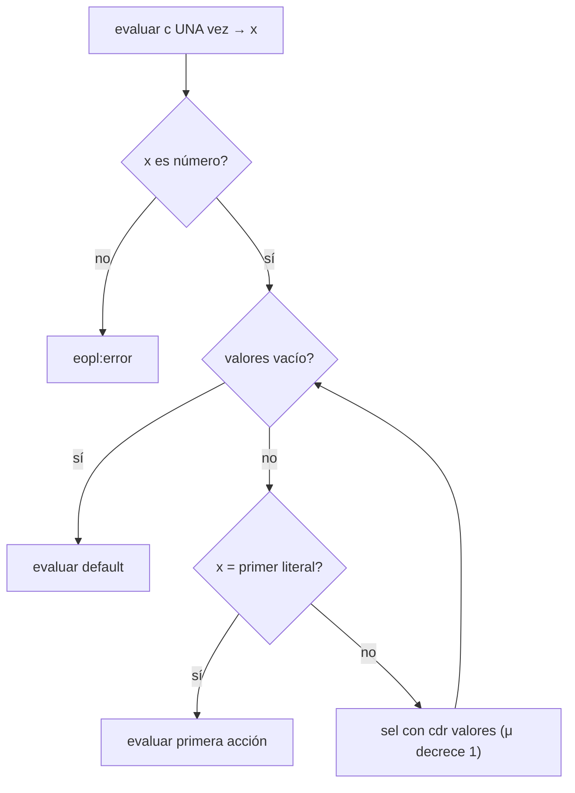

# Informe de corrección — {{Nombre del taller / entrega}}

> **Plantilla de entrega.** Copie este archivo a
> `docs/informe-correccion.md` dentro del repositorio del grupo y
> reemplace los marcadores `{{...}}` con su contenido.
> **No elimine las secciones obligatorias.** No se aceptan PDF, DOCX
> ni imágenes insertadas: todo el documento debe ser Markdown, las
> fórmulas en LaTeX (`$...$` / `$$...$$`) y los diagramas en Mermaid.

**Curso:** Fundamentos de Interpretación y Compilación de Lenguajes
de Programación — Universidad del Valle, Sede Tuluá.

**Integrantes del grupo:**

| Nombre | Código | Correo institucional |
|--------|--------|----------------------|
| {{Nombre 1}} | {{Código 1}} | {{correo1@correounivalle.edu.co}} |
| Carlos Humberto Gutierrez Mejia | 2059817 | carlos.humberto.gutierrez@correounivalle.edu.co |

---

## 1. Marco formal

### 1.1 Corrección de programas recursivos

Sea $f : A \to B$ una función y $A$ un conjunto definido
recursivamente. Sea $P_f$ un programa recursivo en Racket que
pretende calcular $f$. Decimos que $P_f$ es correcto con respecto a
su especificación si se cumple:

$$
\forall a \in A \,:\, P_f(a) = f(a)
$$

La estrategia de demostración es la **inducción estructural**
sobre $A$:

- **Caso base:** para cada valor básico $a_0 \in A$ se verifica
  $P_f(a_0) = f(a_0)$.
- **Caso inductivo:** asumiendo la **hipótesis de inducción**
  $P_f(a') = f(a')$ para las subestructuras $a'$ que forman $a$, se
  demuestra $P_f(a) = f(a)$.

### 1.2 Corrección de programas iterativos

Para un programa iterativo se formalizan:

- Un estado $s$ con componentes relevantes.
- Un estado inicial $s_0$.
- Un estado final reconocido por un predicado $\text{es-final?}(s)$.
- Una **invariante** $\text{Inv}(s)$ que se mantiene entre pasos.
- Una transformación $\text{transformar}(s)$.

La corrección se argumenta demostrando:

1. $\text{Inv}(s_0)$ se cumple al inicio.
2. $\text{Inv}(s) \,\land\, \lnot\text{es-final?}(s)\Rightarrow
   \text{Inv}(\text{transformar}(s))$.
3. $\text{Inv}(s) \,\land\, \text{es-final?}(s)\Rightarrow
   \text{respuesta}(s) = f(\text{entrada})$.
4. El proceso termina (argumentar una función de cota estrictamente
   decreciente sobre $\mathbb{N}$).

---

## 2. Funciones analizadas

> Complete **una subsección por cada función pedida en el enunciado**.
> Copie la plantilla de subsección tantas veces como sea necesario.

### 2.1 Corrección de `{{nombre-funcion-1}}`

**Especificación.**

- **Tipo:** `{{nombre-funcion-1}} : {{Tipo de entrada}} -> {{Tipo de salida}}`
- **Pre-condición:** $\text{Pre}(a) \equiv \{{\ldots}\}$.
- **Post-condición:** $\text{Post}(a, r) \equiv r = f(a)$, donde
  $f$ es {{descripción matemática de la función}}.

**Código.**

```racket
; {{nombre-funcion-1}} : {{contrato}}
; Propósito: {{...}}
(define ({{nombre-funcion-1}} ...)
  ...)
```

**Estrategia de demostración:** {{recursión estructural sobre ... /
iteración con invariante ...}}.

**Demostración.**

- **Caso base** ($a = {{\ldots}}$):

  $$
  P_f({{\ldots}}) \to {{\ldots}} \quad \land \quad f({{\ldots}}) = {{\ldots}}
  $$

  Por lo tanto $P_f({{\ldots}}) = f({{\ldots}})$.

- **Caso inductivo** ($a = {{\ldots}}$): asumimos la hipótesis de
  inducción $P_f(a') = f(a')$ para {{las subestructuras de $a$}}.

  $$
  P_f(a) \to {{\ldots (aplicar una evaluación) \ldots}}
  $$

  Usando la hipótesis de inducción:

  $$
  \quad = {{\ldots}} = f(a).
  $$

- **Terminación.** {{Identifique la medida que decrece estrictamente
  en cada llamada recursiva — por ejemplo, la longitud de la lista o
  el tamaño del AST — y argumente que está acotada inferiormente.}}

**Conclusión:** $\forall a \in A \,:\, P_f(a) = f(a)$, por lo tanto
`{{nombre-funcion-1}}` es correcta respecto a su especificación.

---

### 2.2 Corrección de `{{nombre-funcion-2}}`

**Especificación.**

- **Tipo:** `{{...}}`
- **Pre-condición:** $\{{\ldots}\}$.
- **Post-condición:** $\{{\ldots}\}$.

**Código.**

```racket
(define ({{nombre-funcion-2}} ...)
  ...)
```

**Demostración.** {{Siga el mismo esquema: casos base, caso
inductivo con hipótesis de inducción y terminación. Para casos de
error explícitos —por ejemplo `eopl:error` cuando una condición no
es booleana— demuestre que el programa levanta el error en ese caso y
sólo en ese caso.}}

---

### 2.3 Corrección de `case-exp`

#### 2.3.1 Especificación formal

Sea $\rho$ un ambiente. Una expresión `case` tiene la forma

$$
\texttt{case-exp}(c,\ V,\ A,\ d), \qquad V = (v_1,\dots,v_k),\quad A = (a_1,\dots,a_k)
$$

donde $c$ es la expresión de control, cada $v_i$ es un literal numérico,
cada $a_i$ es la acción de la rama $i$ y $d$ es la acción de `otherwise`.

- **Tipo:** `evaluar-expresion : expresion x ambiente -> valor`, restringida a `case-exp`.
- **Pre-condición:** $\text{Pre}(c,V,A,d,\rho) \equiv |V| = |A| \;\land\; \rho \text{ es un ambiente}$.
  La igualdad $|V|=|A|$ la garantiza el parser: la gramática declara cada rama
  `of <numero> => <expresion>` con un solo `arbno`, que produce las dos listas en paralelo.
- **Post-condición:** sea $x = \text{value-of}(c,\rho)$.

$$
\text{value-of}(\texttt{case-exp}(c,V,A,d),\rho) =
\begin{cases}
\textbf{error} & \text{si } x \notin \mathbb{R} \\[4pt]
\text{value-of}(a_i,\rho) & \text{si } x\in\mathbb{R},\ \exists j.\ x=v_j,\ \text{con } i=\min\{\,j \mid x = v_j\,\} \\[4pt]
\text{value-of}(d,\rho) & \text{si } x\in\mathbb{R}\ \text{y}\ \forall j.\ x \neq v_j
\end{cases}
$$

**Código analizado** (`src/interprete.rkt`):

```racket
(case-exp (control valores acciones default)
  (let ((control-value (evaluar-expresion control env)))
    (if (number? control-value)
        (seleccionar-rama control-value valores acciones default env)
        (eopl:error 'case-exp
                    "El valor de control debe ser numerico, se recibio: ~s"
                    control-value))))

(define seleccionar-rama
  (lambda (control-value valores acciones default env)
    (cond
      [(null? valores) (evaluar-expresion default env)]
      [(= control-value (car valores))
       (evaluar-expresion (car acciones) env)]
      [else
       (seleccionar-rama control-value (cdr valores) (cdr acciones)
                         default env)])))
```

Para el análisis se escribe $\text{sel}(x, V, A, d, \rho)$ por `seleccionar-rama`.

#### 2.3.2 Inducción estructural sobre la lista de ramas

**Lema.** Para todo número $x$ y todo par de listas $V, A$ con $|V| = |A| = k$:

$$
\text{sel}(x,V,A,d,\rho) =
\begin{cases}
\text{value-of}(a_i,\rho) & \text{si } i=\min\{\,j \mid x=v_j\,\} \text{ existe} \\
\text{value-of}(d,\rho) & \text{si no existe tal } j
\end{cases}
$$

La demostración es por inducción sobre $k$, la longitud de la lista de ramas.

**Caso base** ($k=0$, $V=A=()$). La condición `(null? valores)` es verdadera, por lo
que $\text{sel}(x,(),(),d,\rho)=\text{value-of}(d,\rho)$. Como la lista es vacía, no existe
ningún $j$ con $x=v_j$, y la especificación exige exactamente $\text{value-of}(d,\rho)$. ✓

**Caso inductivo** ($k=n+1$, $V=(v_1\ .\ V')$, $A=(a_1\ .\ A')$ con $|V'|=|A'|=n$).
**Hipótesis de inducción (HI):** el lema vale para $V', A'$.
Como $k\ge 1$, `valores` no es vacía, así que la primera cláusula no se cumple.
Además $|A|=|V|\ge1$, por lo que `(car acciones)` existe. Hay dos subcasos:

1. $x = v_1$. La segunda cláusula se cumple y se obtiene $\text{value-of}(a_1,\rho)$.
   El menor índice con $x=v_j$ es $i=1$, por lo que coincide con la especificación. ✓
2. $x \neq v_1$. Se llega a `else` y $\text{sel}(x,V,A,d,\rho)=\text{sel}(x,V',A',d,\rho)$.
   Por la HI esto vale $\text{value-of}(a'_{i'},\rho)$, con $i'$ el menor índice en $V'$ tal que
   $x=v'_{i'}$, o $\text{value-of}(d,\rho)$ si no existe. Como $v_1$ no coincide, el menor
   índice de $V$ es $i=i'+1$ y $a_i=a'_{i'}$; si no hay coincidencia en $V'$, tampoco en $V$. ✓

Queda probado que **se evalúa la acción de la primera coincidencia** y que **se evalúa
`otherwise` cuando no hay ninguna**. $\blacksquare$

**Error ante control no numérico.** El `if` de la variante `case-exp` solo invoca
`seleccionar-rama` cuando `(number? control-value)` es verdadero; en caso contrario
ejecuta `eopl:error` y no evalúa ninguna rama. Por lo tanto el error se levanta
**exactamente** cuando $x\notin\mathbb{R}$ (por ejemplo, `case true of 1 => 1 otherwise => 0 end`). ✓

#### 2.3.3 La expresión de control se evalúa una sola vez

`evaluar-expresion` invoca `(evaluar-expresion control env)` **una vez**, en el `let`, y
liga el resultado a `control-value`. A `seleccionar-rama` se le pasa ese **valor**, no
la expresión $c$. Las llamadas recursivas de `seleccionar-rama` reenvían `control-value`
sin cambios y el cuerpo de la función nunca recibe $c$, así que no puede evaluarla de nuevo.

Sea $N_c(k)$ el número de evaluaciones de $c$ para una expresión con $k$ ramas. Cada
llamada de `sel` evalúa a lo sumo **una** acción ($a_i$ o $d$), nunca $c$. Entonces
$N_c(k)=1$ para todo $k\ge 0$: es **constante e independiente del número de ramas**.
Además, las acciones de las ramas que no coinciden **nunca se evalúan**.

#### 2.3.4 Terminación

La medida es $\mu = |V|\in\mathbb{N}$, la longitud de la lista de literales que quedan
por revisar.

- En cada llamada recursiva (la cláusula `else`) se pasa `(cdr valores)`, así que
  $\mu$ decrece exactamente en 1.
- La recursión se detiene cuando $\mu = 0$ (`null? valores`), que es la cláusula base.
- $\mu$ está acotada inferiormente por 0 en $\mathbb{N}$, que es un orden bien fundado,
  por lo que no existe una cadena infinita de llamadas.

Por lo tanto el recorrido de las ramas **termina en a lo sumo $k+1$ llamadas**. La terminación de
la evaluación completa de `case` depende, además, de que terminen $c$ y la acción
elegida, que son subexpresiones estrictas del AST (por inducción estructural sobre el árbol).



**Conclusión:** `case-exp` cumple su especificación: selecciona la primera coincidencia,
cae en `otherwise` cuando no hay ninguna, levanta error ante un control no numérico,
evalúa el control una sola vez y el recorrido termina.

---

## 3. Propiedades adicionales (si aplica)

Incluya en esta sección cualquier propiedad adicional que el
enunciado exija demostrar, por ejemplo:

- **Shadowing de ambientes** (`apply-env`): la ligadura más reciente
  tiene prioridad sobre las anteriores.
- **Secuencialidad de `let*`**: cada ligadura se evalúa en un
  ambiente que incluye las anteriores.
- **Equivalencia semántica** entre dos implementaciones (por ejemplo,
  representación basada en listas vs. basada en procedimientos de un
  mismo TAD).
- **Invariante del almacén**: si $\sigma' = \text{setref!}(\sigma, \ell, v)$,
  entonces $\sigma'(\ell) = v$ y $\sigma'(\ell') = \sigma(\ell')$ para todo
  $\ell' \neq \ell$. La operación que reserva una celda es la única que
  cambia la longitud del almacén.
- **Invariante de la transacción**: sea $\sigma_0$ el almacén al entrar a
  un bloque `atomic` y $\sigma$ el almacén en el momento de abortar. Si
  el registro de la transacción guarda, para cada celda $\ell$ escrita
  dentro del bloque, el valor $\sigma_0(\ell)$ que tenía al entrar, y la
  longitud $|\sigma_0|$, entonces revertir devuelve exactamente
  $\sigma_0$: las celdas registradas recuperan su valor, las que no se
  escribieron nunca cambiaron, y las creadas adentro (posiciones
  $\geq |\sigma_0|$) desaparecen. Demostrar por inducción sobre el
  número de escrituras del bloque, y tratar aparte el caso de una
  transacción hija que confirmó antes de que la padre abortara.
- **Paso por referencia**: el parámetro queda ligado a la misma
  referencia del argumento, de modo que una escritura dentro del
  procedimiento se observa fuera. Contrastar con el paso por valor
  sobre el mismo programa.
- **Solidez de un chequeador de tipos**: si $\Gamma \vdash e : t$ y el
  ambiente de valores $\rho$ concuerda con el ambiente de tipos
  $\Gamma$, entonces $\text{value-of}(e, \rho)$ es un valor de tipo
  $t$. Precisar primero qué significa la concordancia entre $\rho$ y
  $\Gamma$.

Cada propiedad debe enunciarse formalmente y demostrarse con el
mismo rigor que las funciones anteriores.

---

## 4. Referencias

- Friedman, D. P., & Wand, M. *Essentials of Programming Languages*,
  3.ª ed., MIT Press, 2008. Secciones {{…}}.
- {{Otras referencias que hayan consultado.}}
