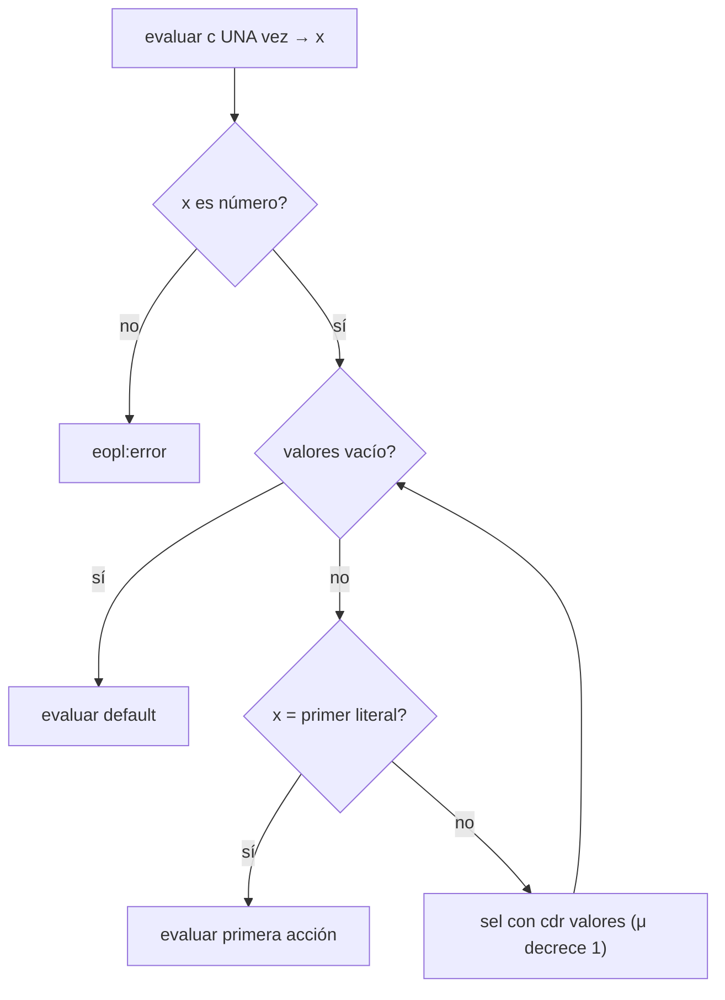

# Informe de corrección — Taller 2: El intérprete de Cauca.


**Curso:** Fundamentos de Interpretación y Compilación de Lenguajes
de Programación — Universidad del Valle, Sede Tuluá.

**Integrantes del grupo:**

| Nombre | Código | Correo institucional |
|--------|--------|----------------------|
| Jesus David Lopez Diaz | 2611029-3743  | jesus.david.lopez@correounivalle.edu.co |
| Carlos Humberto Gutierrez Mejia | 2059817-3743 | carlos.humberto.gutierrez@correounivalle.edu.co |

---

## 1. Marco formal

### 1.1 Corrección de programas recursivos

Sea $f : A \to B$ una función y $A$ un conjunto definido
recursivamente. Sea $P_f$ un programa recursivo en Racket que
pretende calcular $f$. Decimos que $P_f$ es correcto con respecto a
su especificación si se cumple:

$$
\forall a \in A \,:\, P_f(a) = f(a)
$$

La estrategia de demostración es la **inducción estructural**
sobre $A$:

- **Caso base:** para cada valor básico $a_0 \in A$ se verifica
  $P_f(a_0) = f(a_0)$.
- **Caso inductivo:** asumiendo la **hipótesis de inducción**
  $P_f(a') = f(a')$ para las subestructuras $a'$ que forman $a$, se
  demuestra $P_f(a) = f(a)$.

### 1.2 Corrección de programas iterativos

Para un programa iterativo se formalizan:

- Un estado $s$ con componentes relevantes.
- Un estado inicial $s_0$.
- Un estado final reconocido por un predicado $\text{es-final?}(s)$.
- Una **invariante** $\text{Inv}(s)$ que se mantiene entre pasos.
- Una transformación $\text{transformar}(s)$.

La corrección se argumenta demostrando:

1. $\text{Inv}(s_0)$ se cumple al inicio.
2. $\text{Inv}(s) \,\land\, \lnot\text{es-final?}(s)\Rightarrow
   \text{Inv}(\text{transformar}(s))$.
3. $\text{Inv}(s) \,\land\, \text{es-final?}(s)\Rightarrow
   \text{respuesta}(s) = f(\text{entrada})$.
4. El proceso termina (argumentar una función de cota estrictamente
   decreciente sobre $\mathbb{N}$).

---

## 2. Funciones analizadas

> Complete **una subsección por cada función pedida en el enunciado**.
> Copie la plantilla de subsección tantas veces como sea necesario.


### 2.1 Corrección de `apply-procedure` (enunciado, 6.1)

Notación. $\rho$ es un ambiente; $\rho[\bar{x} = \bar{v}]$ es $\rho$ extendido con las ligaduras $x_1 = v_1, \dots, x_n = v_n$ (las nuevas tapan a las anteriores con el mismo nombre); $\text{value-of}(e, \rho)$ es el valor de la expresión $e$ en $\rho$. Una clausura se escribe $\langle \bar{x};\ b;\ \rho_d \rangle$: parámetros, cuerpo sin evaluar y ambiente de definición.

Especificación.

Tipo: apply-procedure : procval x lista de valores -> valor
Pre-condición: $\text{Pre}(f, \bar{v}) \equiv f = \langle x_1,\dots,x_n;\ b;\ \rho_d \rangle \;\land\; |\bar{v}| = n$.
Post-condición: $\text{Post}(f, \bar{v}, r) \equiv r = \text{value-of}\bigl(b,\ \rho_d[\bar{x} = \bar{v}]\bigr)$.
Fuera de la pre-condición: si $f$ no es una clausura, o si $|\bar{v}| \neq n$, la función levanta eopl:error y no evalúa el cuerpo.

proc-exp y app-exp completan la semántica:

$$\text{value-of}(\texttt{proc}\ (\bar{x})\ b\ \texttt{end},\ \rho) = \langle \bar{x};\ b;\ \rho \rangle$$
$$
\text{value-of}(\texttt{apply}\ e_0\ (e_1,\dots,e_k),\ \rho) =
\texttt{apply-procedure}\bigl(\text{value-of}(e_0,\rho),\ [\text{value-of}(e_1,\rho),\dots,\text{value-of}(e_k,\rho)]\bigr)
$$

Código.

racket
(proc-exp (ids body)
  (cerradura ids body env))

(app-exp (rator rands)
  (let ((proc (evaluar-expresion rator env)))
    (if (procval? proc)
        (let ((args (evaluar-rands rands env)))
          (apply-procedure proc args))
        (eopl:error 'app-exp "El operador no es un procedimiento: ~s" proc))))

; apply-procedure : procval x lista de valores -> valor
; Propósito: evalúa el cuerpo en el ambiente de la clausura extendido con
; los parámetros, no en el ambiente de la llamada.
(define apply-procedure
  (lambda (proc args)
    (if (not (procval? proc))
        (eopl:error 'apply-procedure "No es un procedimiento: ~s" proc)
        (cases procval proc
          (cerradura (ids body env)
            (if (= (length ids) (length args))
                (evaluar-expresion body (ambiente-extendido ids args env))
                (eopl:error 'apply-procedure
                            "Se esperaban ~s argumentos y se recibieron ~s"
                            (length ids) (length args))))))))

Estrategia de demostración: la función no es recursiva, así que no hay inducción: se razona por casos sobre el código y se contrastan las cadenas de ambientes del ejemplo del enunciado.

Demostración.

(a) El cuerpo se evalúa en el ambiente de la clausura, no en el de la llamada.

Por construcción. apply-procedure tiene la forma (lambda (proc args) ...): no recibe el ambiente de la llamada $\rho_c$, así que no puede usarlo. El único ambiente a su alcance es el campo env de la clausura, que proc-exp fijó con el ambiente vigente al definirla. El cuerpo se evalúa en (ambiente-extendido ids args env), es decir, en $\rho_d[\bar{x} = \bar{v}]$. El ambiente de la llamada solo se usa antes, para evaluar el operador y los operandos.

Con el ejemplo de contraste. Se evalúa el programa del enunciado desde el ambiente inicial $\rho_0 = [\,n = 10, m = 3, p = 7, q = 2, r = 5\,]$:

let factor = 10
in
  let escalar = proc (v) *(v, factor) end
  in
    let factor = 1000
    in
      apply escalar (5)
    end
  end
end
Ambiente	Contenido	Dónde se crea
$\rho_1$	$[\,\texttt{factor} = 10\,]\rho_0$	primer let
$c$	$\langle (v);\ \texttt{*(v, factor)};\ \rho_1 \rangle$	proc-exp, evaluado en $\rho_1$
$\rho_2$	$[\,\texttt{escalar} = c\,]\rho_1$	segundo let
$\rho_3$	$[\,\texttt{factor} = 1000\,]\rho_2$	tercer let: ambiente de la llamada

Al evaluar apply escalar (5) en $\rho_3$, el operador escalar no está en $\rho_3$ y se encuentra en $\rho_2$, donde vale $c$. El argumento vale $5$. Hay dos decisiones posibles:

Ambiente de la definición (correcto, resultado 50). El cuerpo se evalúa en $\rho_4 = [\,v = 5\,]\rho_1$. Para factor, la búsqueda sale de $\rho_4$ y encuentra $10$ en $\rho_1$:

$$\text{value-of}(\texttt{*(v, factor)},\ \rho_4) = 5 \cdot 10 = 50$$
ρ4 = [v = 5]
ρ1 = [factor = 10]
ρ0 = [n = 10, m = 3, p = 7,q = 2, r = 5]
ambiente-vacio

Ambiente de la llamada (incorrecto, resultado 5000). El cuerpo se evaluaría en $\rho_5 = [\,v = 5\,]\rho_3$, donde factor se encuentra primero en $\rho_3$ con $1000$:

$$\text{value-of}(\texttt{*(v, factor)},\ \rho_5) = 5 \cdot 1000 = 5000$$
ρ5 = [v = 5]
ρ3 = [factor = 1000]
ρ2 = [escalar = c]
ρ1 = [factor = 10]
ρ0 = [n = 10, m = 3, p = 7,q = 2, r = 5]
ambiente-vacio

Las flechas van del ambiente que extiende hacia el ambiente extendido. La cadena de la clausura (primer diagrama) no pasa por $\rho_3$, y por eso el intérprete devuelve $50$: la clausura recuerda el ambiente donde nació el procedimiento.

(b) Error exactamente cuando el operador no es un procedimiento o la aridad no coincide.

Sea $e = \texttt{apply}\ e_0\ (e_1,\dots,e_k)$ y supóngase que evaluar $e_0$ y cada $e_i$ no levanta error. La aplicación levanta eopl:error si y solo si

$$\text{value-of}(e_0,\rho) \notin \text{Procval} \quad \lor \quad k \neq n .$$
app-exp evalúa el operador y pregunta (procval? proc). El datatype procval tiene una sola variante, cerradura, así que procval? es verdadero exactamente para las clausuras; los números y los booleanos dan falso. Si es falso, app-exp levanta eopl:error y no evalúa los operandos.
Si es verdadero, se evalúan los operandos y se llama a apply-procedure. Esta función repite la verificación procval?, abre la clausura con cases y compara (length ids) con (length args). Si son distintos levanta eopl:error.
Si el operador es una clausura y $k = n$, ninguna de las dos ramas con eopl:error se ejecuta: la aplicación evalúa el cuerpo en $\rho_d[\bar{x} = \bar{v}]$. Cualquier error posterior viene de evaluar el cuerpo, no de la aplicación.

Los dos casos se comprueban en las pruebas con apply 5 (1) y con let f = proc (x) x end in apply f (1, 2) end.

Terminación. apply-procedure no es recursiva: hace un número fijo de pasos (dos verificaciones, length sobre listas finitas y una extensión de ambiente) y luego evalúa el cuerpo, que es una subexpresión del AST. Termina siempre que la evaluación del cuerpo termine.

Conclusión: apply-procedure es correcta respecto a su especificación: evalúa el cuerpo en $\rho_d[\bar{x} = \bar{v}]$ y levanta error exactamente en los dos casos previstos. $\blacksquare$

---

### 2.2 Corrección de `letrec-exp` (enunciado, 6.2)

Especificación.

Tipo: evaluar-expresion : expresion x ambiente -> valor, restringida a letrec-exp.
Pre-condición: $\text{Pre} \equiv$ los nombres $p_1,\dots,p_n$ son símbolos y $|\bar{x}_i|$ es la aridad de $p_i$.
Post-condición: sea $\rho_r = \texttt{ambiente-recursivo}(p_1..p_n;\ \bar{x}_1..\bar{x}_n;\ b_1..b_n;\ \rho)$.
$$
\text{value-of}(\texttt{letrec}\ p_1(\bar{x}_1) = b_1 \dots p_n(\bar{x}_n) = b_n\ \texttt{in}\ e\ \texttt{end},\ \rho)
= \text{value-of}(e,\ \rho_r)
$$

Código.

racket
(letrec-exp (proc-names idss bodies body)
  (evaluar-expresion
   body
   (ambiente-recursivo proc-names idss bodies env)))

Estrategia de demostración: enunciar un invariante sobre el ambiente $\rho_r$, demostrar que apply-env lo establece, mostrar por contraste que let no lo cumple, y argumentar la terminación del ejemplo con una medida decreciente.

Demostración.

(a) Invariante. Para cada $i \in \{1,\dots,n\}$, la clausura que se obtiene al buscar $p_i$ en $\rho_r$ es

$$\texttt{apply-env}(\rho_r, p_i) = \langle \bar{x}_i;\ b_i;\ \rho_r \rangle \tag{INV}$$

Es decir, su ambiente de definición es el propio $\rho_r$.

Consecuencia. Al aplicar esa clausura a $\bar{v}$, el cuerpo $b_i$ se evalúa en $\rho_r[\bar{x}_i = \bar{v}]$. Ese ambiente contiene los $n$ nombres $p_1,\dots,p_n$ (salvo los que un parámetro de $\bar{x}_i$ tape con el mismo nombre), y cada uno vuelve a producir una clausura con ambiente $\rho_r$. Por eso el procedimiento puede llamarse a sí mismo y a los demás del mismo letrec.

(b) apply-env sobre un ambiente-recursivo satisface el invariante.


apply-env recibe el ambiente $\rho_r$ y el nombre buscado $x$. Si $x = p_i$, la rama de ambiente-recursivo devuelve (cerradura ids_i body_i env) con env igual al ambiente que recibió como argumento, es decir, $\rho_r$. Entonces $\texttt{apply-env}(\rho_r, p_i) = \langle \bar{x}_i;\ b_i;\ \rho_r \rangle$, que es (INV). Si $x$ no es ninguno de los $p_i$, la búsqueda continúa en $\rho$.

La clausura se construye al buscar el nombre y no antes. Por eso no hace falta un ambiente circular ni mutación: $\rho_r$ solo guarda nombres, parámetros y cuerpos sin evaluar, y cada búsqueda arma una clausura nueva que apunta de vuelta a $\rho_r$.

(c) Por qué let no satisface el invariante, y qué error produce. Con let, los operandos se evalúan en el ambiente actual $\rho$, antes de agregar la ligadura:

let potencia = proc (base, exp)
                 if ==(exp, 0) then 1
                 else *(base, apply potencia (base, sub1(exp))) end
               end
in
  apply potencia (2, 10)
end

El proc-exp se evalúa en $\rho$, así que la clausura queda $c = \langle (base, exp);\ b;\ \rho \rangle$ y solo después se construye $\rho_l = [\,\texttt{potencia} = c\,]\rho$. Entonces $\texttt{env}(c) = \rho \neq \rho_l$ y (INV) no se cumple: el ambiente de definición no contiene potencia.

letrec: la clausura captura ρr, que sí la tiene
ρr =ambiente-recursivo(potencia)
ρ
c = ⟨(base, exp); cuerpo; ρr⟩
let: la clausura captura ρ, que no tiene potencia
ρl = [potencia = c]
ρ
c = ⟨(base, exp); cuerpo; ρ⟩

Al evaluar apply potencia (2, 10), el cuerpo corre en $[\,base = 2, exp = 10\,]\rho$. Como $exp \neq 0$, entra por la rama else y evalúa apply potencia (...). La búsqueda de potencia recorre esa cadena hasta ambiente-vacio sin encontrarla, y apply-env levanta eopl:error de variable no ligada, en la primera llamada recursiva. Si $\rho$ ya tuviera otra ligadura llamada potencia, la llamada iría a esa en silencio, que es otro error. Una prueba verifica que la versión con let falla.

(d) Terminación del ejemplo de potencia.

letrec
  potencia (base, exp) = if ==(exp, 0) then 1
                         else *(base, apply potencia (base, sub1(exp))) end
in
  apply potencia (2, 10)
end

La medida es $\mu(\texttt{potencia}(b, k)) = k \in \mathbb{N}$.

La rama base ($k = 0$) devuelve $1$ sin llamadas recursivas.
En la rama recursiva ($k > 0$), la única llamada es potencia(b, sub1(k)), con medida $k - 1 < k$.
$\mathbb{N}$ no tiene cadenas infinitas decrecientes, así que toda secuencia de llamadas se detiene en $k = 0$.

Por inducción sobre $k$ también se obtiene el valor correcto:

$$P(b, 0) = 1, \qquad P(b, k) = b \cdot P(b, k-1) \;\Longrightarrow\; P(b, k) = b^k$$

Para $b = 2$ y $k = 10$, el programa hace $10$ llamadas recursivas más la de base y devuelve $2^{10} = 1024$. Con un exponente negativo o no entero, la medida no llega a $0$ y la ejecución no termina; ese caso queda fuera del dominio $k \in \mathbb{N}$ del ejemplo.

Conclusión: letrec-exp es correcta respecto a su especificación: el ambiente $\rho_r$ cumple (INV), let no lo cumple y falla con variable no ligada, y el ejemplo de potencia termina con $1024$. $\blacksquare$

### 2.3 Corrección de `case-exp`

#### 2.3.1 Especificación formal

Sea $\rho$ un ambiente. Una expresión `case` tiene la forma

$$
\texttt{case-exp}(c,\ V,\ A,\ d), \qquad V = (v_1,\dots,v_k),\quad A = (a_1,\dots,a_k)
$$

donde $c$ es la expresión de control, cada $v_i$ es un literal numérico,
cada $a_i$ es la acción de la rama $i$ y $d$ es la acción de `otherwise`.

- **Tipo:** `evaluar-expresion : expresion x ambiente -> valor`, restringida a `case-exp`.
- **Pre-condición:** $\text{Pre}(c,V,A,d,\rho) \equiv |V| = |A| \;\land\; \rho \text{ es un ambiente}$.
  La igualdad $|V|=|A|$ la garantiza el parser: la gramática declara cada rama
  `of <numero> => <expresion>` con un solo `arbno`, que produce las dos listas en paralelo.
- **Post-condición:** sea $x = \text{value-of}(c,\rho)$.

$$
\text{value-of}(\texttt{case-exp}(c,V,A,d),\rho) =
\begin{cases}
\textbf{error} & \text{si } x \notin \mathbb{R} \\[4pt]
\text{value-of}(a_i,\rho) & \text{si } x\in\mathbb{R},\ \exists j.\ x=v_j,\ \text{con } i=\min\{\,j \mid x = v_j\,\} \\[4pt]
\text{value-of}(d,\rho) & \text{si } x\in\mathbb{R}\ \text{y}\ \forall j.\ x \neq v_j
\end{cases}
$$

**Código analizado** (`src/interprete.rkt`):

```racket
(case-exp (control valores acciones default)
  (let ((control-value (evaluar-expresion control env)))
    (if (number? control-value)
        (seleccionar-rama control-value valores acciones default env)
        (eopl:error 'case-exp
                    "El valor de control debe ser numerico, se recibio: ~s"
                    control-value))))

(define seleccionar-rama
  (lambda (control-value valores acciones default env)
    (cond
      [(null? valores) (evaluar-expresion default env)]
      [(= control-value (car valores))
       (evaluar-expresion (car acciones) env)]
      [else
       (seleccionar-rama control-value (cdr valores) (cdr acciones)
                         default env)])))
```

Para el análisis se escribe $\text{sel}(x, V, A, d, \rho)$ por `seleccionar-rama`.

#### 2.3.2 Inducción estructural sobre la lista de ramas

**Lema.** Para todo número $x$ y todo par de listas $V, A$ con $|V| = |A| = k$:

$$
\text{sel}(x,V,A,d,\rho) =
\begin{cases}
\text{value-of}(a_i,\rho) & \text{si } i=\min\{\,j \mid x=v_j\,\} \text{ existe} \\
\text{value-of}(d,\rho) & \text{si no existe tal } j
\end{cases}
$$

La demostración es por inducción sobre $k$, la longitud de la lista de ramas.

**Caso base** ($k=0$, $V=A=()$). La condición `(null? valores)` es verdadera, por lo
que $\text{sel}(x,(),(),d,\rho)=\text{value-of}(d,\rho)$. Como la lista es vacía, no existe
ningún $j$ con $x=v_j$, y la especificación exige exactamente $\text{value-of}(d,\rho)$. ✓

**Caso inductivo** ($k=n+1$, $V=(v_1\ .\ V')$, $A=(a_1\ .\ A')$ con $|V'|=|A'|=n$).
**Hipótesis de inducción (HI):** el lema vale para $V', A'$.
Como $k\ge 1$, `valores` no es vacía, así que la primera cláusula no se cumple.
Además $|A|=|V|\ge1$, por lo que `(car acciones)` existe. Hay dos subcasos:

1. $x = v_1$. La segunda cláusula se cumple y se obtiene $\text{value-of}(a_1,\rho)$.
   El menor índice con $x=v_j$ es $i=1$, por lo que coincide con la especificación. ✓
2. $x \neq v_1$. Se llega a `else` y $\text{sel}(x,V,A,d,\rho)=\text{sel}(x,V',A',d,\rho)$.
   Por la HI esto vale $\text{value-of}(a'_{i'},\rho)$, con $i'$ el menor índice en $V'$ tal que
   $x=v'_{i'}$, o $\text{value-of}(d,\rho)$ si no existe. Como $v_1$ no coincide, el menor
   índice de $V$ es $i=i'+1$ y $a_i=a'_{i'}$; si no hay coincidencia en $V'$, tampoco en $V$. ✓

Queda probado que **se evalúa la acción de la primera coincidencia** y que **se evalúa
`otherwise` cuando no hay ninguna**. $\blacksquare$

**Error ante control no numérico.** El `if` de la variante `case-exp` solo invoca
`seleccionar-rama` cuando `(number? control-value)` es verdadero; en caso contrario
ejecuta `eopl:error` y no evalúa ninguna rama. Por lo tanto el error se levanta
**exactamente** cuando $x\notin\mathbb{R}$ (por ejemplo, `case true of 1 => 1 otherwise => 0 end`). ✓

#### 2.3.3 La expresión de control se evalúa una sola vez

`evaluar-expresion` invoca `(evaluar-expresion control env)` **una vez**, en el `let`, y
liga el resultado a `control-value`. A `seleccionar-rama` se le pasa ese **valor**, no
la expresión $c$. Las llamadas recursivas de `seleccionar-rama` reenvían `control-value`
sin cambios y el cuerpo de la función nunca recibe $c$, así que no puede evaluarla de nuevo.

Sea $N_c(k)$ el número de evaluaciones de $c$ para una expresión con $k$ ramas. Cada
llamada de `sel` evalúa a lo sumo **una** acción ($a_i$ o $d$), nunca $c$. Entonces
$N_c(k)=1$ para todo $k\ge 0$: es **constante e independiente del número de ramas**.
Además, las acciones de las ramas que no coinciden **nunca se evalúan**.

#### 2.3.4 Terminación

La medida es $\mu = |V|\in\mathbb{N}$, la longitud de la lista de literales que quedan
por revisar.

- En cada llamada recursiva (la cláusula `else`) se pasa `(cdr valores)`, así que
  $\mu$ decrece exactamente en 1.
- La recursión se detiene cuando $\mu = 0$ (`null? valores`), que es la cláusula base.
- $\mu$ está acotada inferiormente por 0 en $\mathbb{N}$, que es un orden bien fundado,
  por lo que no existe una cadena infinita de llamadas.

Por lo tanto el recorrido de las ramas **termina en a lo sumo $k+1$ llamadas**. La terminación de
la evaluación completa de `case` depende, además, de que terminen $c$ y la acción
elegida, que son subexpresiones estrictas del AST (por inducción estructural sobre el árbol).



**Conclusión:** `case-exp` cumple su especificación: selecciona la primera coincidencia,
cae en `otherwise` cuando no hay ninguna, levanta error ante un control no numérico,
evalúa el control una sola vez y el recorrido termina.

---

### 3.1 Corrección de `apply-env` sobre `ambiente-recursivo`

Esta subsección demuestra el punto 2 de la sección 6.2 del enunciado: que
`apply-env`, al encontrar un nombre ligado por `letrec`, construye una clausura que
satisface el invariante de la ligadura recursiva. También enuncia la propiedad de
shadowing de `ambiente-extendido`.

#### 3.1.1 Definiciones

Sea $\rho_{rec} = \texttt{ambiente-recursivo}(F, P, B, \rho)$ con

$$
F = (f_1,\dots,f_k),\quad P = (P_1,\dots,P_k),\quad B = (b_1,\dots,b_k),
$$

donde $f_i$ es el nombre, $P_i$ la lista de parámetros y $b_i$ el cuerpo (sin evaluar)
del $i$-ésimo procedimiento. Se supone que los nombres $f_i$ son distintos entre sí y
que $|F|=|P|=|B|=k$ (lo garantiza el parser, que produce las tres listas con un solo `arbno`).

**Invariante de la ligadura recursiva** $\text{InvRec}(\rho_{rec})$:

$$
\forall i \in \{1,\dots,k\}:\quad
\text{apply-env}(\rho_{rec}, f_i) = \texttt{cerradura}(P_i,\ b_i,\ \rho_{rec})
$$

Es decir, la clausura de cada $f_i$ guarda como ambiente al **propio** $\rho_{rec}$, que
contiene los nombres de todos los procedimientos del mismo `letrec`, incluido el suyo.

**Código analizado** (`src/ambiente.rkt`):

```racket
(define buscar-recursivo
  (lambda (id nombres idss bodies amb-rec resto)
    (cond
      [(null? nombres) (apply-env resto id)]
      [(eqv? id (car nombres))
       (cerradura (car idss) (car bodies) amb-rec)]
      [else (buscar-recursivo id (cdr nombres) (cdr idss) (cdr bodies)
                              amb-rec resto)])))

;; dentro de apply-env:
(ambiente-recursivo (proc-names idss bodies resto)
  (buscar-recursivo id proc-names idss bodies env resto))
```

Aquí `env` es el ambiente recursivo completo, que `apply-env` recibió como argumento.

#### 3.1.2 Lema: `buscar-recursivo` recorre la lista de nombres

**Lema A.** Sean $N=(n_1,\dots,n_m)$, $Q=(Q_1,\dots,Q_m)$ y $C=(c_1,\dots,c_m)$ listas de la misma
longitud $m$, y sean $\alpha$ y $\rho_0$ ambientes. Entonces:

$$
\text{buscar-rec}(id, N, Q, C, \alpha, \rho_0) =
\begin{cases}
\texttt{cerradura}(Q_j,\ c_j,\ \alpha) & \text{si } j=\min\{\,l \mid id = n_l\,\}\text{ existe} \\
\text{apply-env}(\rho_0,\ id) & \text{si } id \notin N
\end{cases}
$$

**Demostración** por inducción sobre $m$.

- **Caso base** ($m=0$). `(null? nombres)` es verdadero y el resultado es
  $\text{apply-env}(\rho_0, id)$. Como $N$ es vacía, $id\notin N$. ✓
- **Caso inductivo** ($m=n+1$, $N=(n_1\ .\ N')$, $Q=(Q_1\ .\ Q')$, $C=(c_1\ .\ C')$).
  **HI:** el lema vale para $N',Q',C'$ (de longitud $n$).
  - Si $id=n_1$, la segunda cláusula devuelve $\texttt{cerradura}(Q_1, c_1, \alpha)$ con $j=1$. ✓
  - Si $id\neq n_1$, se llega a `else` y el resultado es
    $\text{buscar-rec}(id,N',Q',C',\alpha,\rho_0)$, que por la HI es
    $\texttt{cerradura}(Q'_{j'}, c'_{j'},\alpha)$ con $j'$ el menor índice de $N'$ (equivalente
    a $j=j'+1$ en $N$), o bien $\text{apply-env}(\rho_0,id)$ si $id\notin N'$, que equivale
    a $id\notin N$ porque $n_1\neq id$. ✓

**Terminación.** La medida $m=|N|\in\mathbb{N}$ decrece en 1 en cada llamada recursiva
(`cdr` de las tres listas) y la recursión se detiene en $m=0$. $\blacksquare$

## 3. Propiedades adicionales

#### 3.1.3 Teorema: `apply-env` sobre `ambiente-recursivo` cumple el invariante

**Teorema.** Para todo $\rho_{rec}=\texttt{ambiente-recursivo}(F,P,B,\rho)$ con nombres distintos,
$\text{InvRec}(\rho_{rec})$ se cumple. Además, para todo $id\notin F$:
$\text{apply-env}(\rho_{rec},id)=\text{apply-env}(\rho,id)$.

**Demostración.** En la variante `ambiente-recursivo`, `apply-env` llama a
$\text{buscar-rec}(id, F, P, B, \rho_{rec}, \rho)$, entregando como $\alpha$ al ambiente
recursivo completo (`env`). Se aplica el Lema A con $N=F$, $Q=P$, $C=B$, $\alpha=\rho_{rec}$:

- Si $id=f_i$, como los nombres son distintos el menor índice es $i$, y el resultado es
  $\texttt{cerradura}(P_i, b_i, \rho_{rec})$. Esto es exactamente $\text{InvRec}(\rho_{rec})$. ✓
- Si $id\notin F$, el resultado es $\text{apply-env}(\rho, id)$: la búsqueda continúa en el
  ambiente de afuera y los ligamientos anteriores no se alteran. ✓ $\blacksquare$

#### 3.1.4 Consecuencia: el cuerpo de cada procedimiento ve a todos los del `letrec`

Al aplicar la clausura $\texttt{cerradura}(P_i,b_i,\rho_{rec})$ con argumentos $\vec{v}$,
`apply-procedure` evalúa $b_i$ en

$$
\rho_i' = \texttt{ambiente-extendido}(P_i,\ \vec{v},\ \rho_{rec}).
$$

**Proposición.** Para todo $f_j\in F$ con $f_j\notin P_i$:

$$
\text{apply-env}(\rho_i', f_j) = \texttt{cerradura}(P_j,\ b_j,\ \rho_{rec}).
$$

*Demostración.* `buscar-extendido` recorre los parámetros $P_i$ sin encontrar $f_j$
(por inducción sobre $|P_i|$: cada paso descarta un elemento distinto de $f_j$) y delega en
$\text{apply-env}(\rho_{rec},f_j)$, que por el Teorema vale $\texttt{cerradura}(P_j,b_j,\rho_{rec})$. $\blacksquare$

En particular para $j=i$: el cuerpo $b_i$ puede invocar al procedimiento $f_i$ (recursión
directa) y a cualquier $f_j$ del mismo `letrec` (recursión mutua). Si un parámetro se
llama igual que algún $f_j$, lo tapa por shadowing, que es el comportamiento léxico esperado.

El cuerpo del `letrec` (la expresión después de `in`) se evalúa directamente en
$\rho_{rec}$, y ahí $\text{InvRec}(\rho_{rec})$ vale por el Teorema.

**Observación.** La clausura se construye cada vez que se busca el nombre, no se guarda.
Como `cerradura` es un dato inmutable que depende solo de $(P_i,b_i,\rho_{rec})$, dos
búsquedas del mismo nombre devuelven clausuras estructuralmente iguales y el
comportamiento es el mismo que si se hubiera guardado una sola.

#### 3.1.5 Shadowing en `ambiente-extendido`

**Propiedad.** Si $\rho = \texttt{ambiente-extendido}((x_1,\dots,x_m),(v_1,\dots,v_m),\rho_0)$:

$$
\text{apply-env}(\rho, id) =
\begin{cases}
v_j & \text{si } j=\min\{\,l \mid id=x_l\,\}\text{ existe} \\
\text{apply-env}(\rho_0, id) & \text{si } id\notin\{x_1,\dots,x_m\}
\end{cases}
$$

*Demostración.* Inducción sobre $m$, igual que el Lema A: en el caso base `buscar-extendido`
delega en $\rho_0$; en el inductivo devuelve `(car vals)` si $id=x_1$ y si no recurre sobre
`(cdr ids)` y `(cdr vals)`. La ligadura más reciente (la del marco más interno) se revisa
antes que las de $\rho_0$, y por eso las tapa. La medida $m$ decrece en 1. $\blacksquare$

Ejemplo: en `let n = 99 in n end` el marco de `n = 99` se revisa antes que el del
ambiente inicial (`n = 10`), así que el resultado es $99$.

---

## 4. Referencias

- Friedman, D. P., & Wand, M. *Essentials of Programming Languages*,
  3.ª ed., MIT Press, 2008. Sección 1.1 (especificación inductiva de
  datos), sección 1.2 (definición de procedimientos recursivos sobre
  datos inductivos, base de las demostraciones por inducción
  estructural), sección 3.2 (el lenguaje LET, `value-of` y la
  especificación de `if` y `let`), sección 3.3 (procedimientos y
  clausuras, Figura 3.7) y sección 3.4 (procedimientos recursivos,
  Figura 3.9, que sustenta `ambiente-recursivo`).
- Friedman, D. P., & Wand, M. *Essentials of Programming Languages*,
  3.ª ed., MIT Press, 2008. Sección 2.2 (representación de ambientes) y
  Apéndice B, *SLLGEN: Parsing System*, para la gramática de Cauca y los
  datatypes que genera.
- *The Racket Reference*, secciones sobre números (`remainder`,
  `quotient`, `integer?`, `exact?`), documentación de `eopl`.
  <https://docs.racket-lang.org/reference/numbers.html>
- *RackUnit: Unit Testing*, para la batería de pruebas del taller.
  <https://docs.racket-lang.org/rackunit/>
